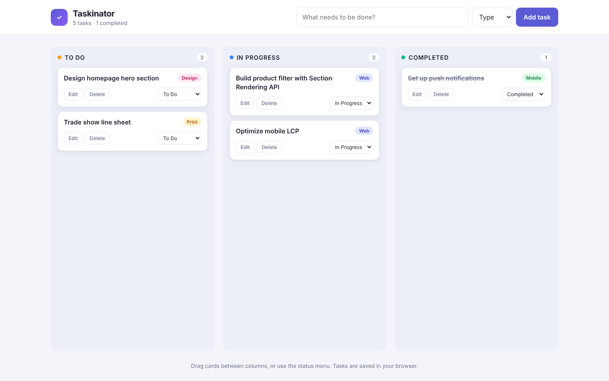

# Taskinator

A Kanban-style task organizer. Add tasks, move them from To Do to In Progress to Completed, and pick up where you left off: everything is saved in the browser.

**Live demo:** https://jhwang2525.github.io/taskinator/

## Features

- Add tasks with a name and type (Web, Mobile, Design, Print)
- Drag and drop cards between columns, or change status from a menu
- Edit and delete tasks
- Live task counts per column and an overall summary
- Tasks persist in `localStorage`
- Responsive layout, keyboard-accessible controls

## Built with

HTML, CSS and vanilla JavaScript (HTML5 Drag and Drop API, `localStorage`).

## Run locally

Open `index.html` in a browser.
